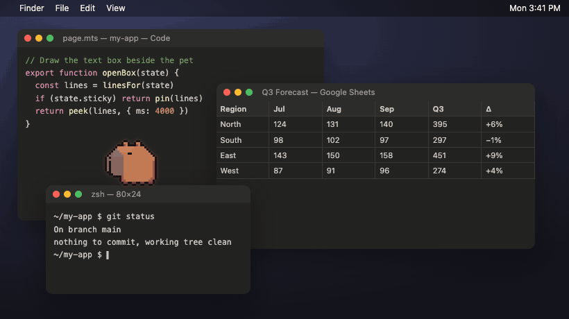
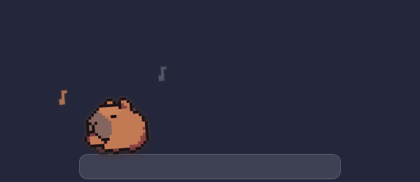

<div align="center">

# hookpet

**A desktop pet for macOS that shows what Claude Code is doing.**


[](LICENSE)

[Install](#install) · [Try it in your browser](https://jaysteezy-max.github.io/hookpet/) · [Tricks](#tricks) · [FAQ](#faq) · [Privacy](#privacy) · [Write a trick](TRICKS.md)



<sub>Clawd on a window ledge, following one Claude Code turn: thinking, editing, running a command, waiting on you, done.</sub>

</div>

> **Unofficial fan project.** Not affiliated with, endorsed by or sponsored by Anthropic. Claude, Claude Code and Clawd
> are Anthropic's. The optional fan pack is fan art of other people's characters (see [Fan pack](#fan-pack)).

- **Knows what Claude is doing.** A status bubble beside him says it in Claude Code's own words: the plan step, the file
  being edited, the command running, the question waiting on you. It opens by itself only when it matters.
- **Lives on your real windows.** He walks along the Dock and the tops of your windows, rides a window you drag, hangs
  from a maximized one, climbs the sides of the screen and phases through its edges.
- **Read-only and local.** The hook can't approve, block or change anything Claude does, and nothing leaves your Mac.
- **Native and light.** A small Swift app that builds on your Mac in seconds. The hook takes about 5 ms per event.
- **Easy to teach new tricks.** Each trick is one JavaScript file, and you can try it in a browser before installing.

## Install

**You need:** a Mac (tested on macOS 27; it should run on macOS 12.3 or later), [Claude Code](https://code.claude.com),
and Apple's free command line tools, which the installer offers to install if they're missing.

```bash
git clone https://github.com/jaysteezy-max/hookpet.git && cd hookpet && ./install.sh
```

1. The installer builds hookpet into `~/.claude/hookpet` and starts it: Clawd appears at the bottom right of your screen.
2. It shows the hooks it wants to add to `~/.claude/settings.json` and **asks first**. If you say yes, it backs that
   file up as `settings.json.hookpet-backup-<time>` and leaves everything else in it as it was.
3. **Check it works:** start a new Claude Code session and send a prompt. Clawd puts a hand to his chin and his
   status bubble says what Claude is doing.

Run `./install.sh` again any time to update.

<details>
<summary>Exactly what changes in settings.json</summary>

One command is added to ten [hook events](https://code.claude.com/docs/en/hooks): `SessionStart`,
`UserPromptSubmit`, `PreToolUse`, `PostToolUse`, `PostToolUseFailure`, `PermissionRequest`, `Notification`, `Stop`,
`StopFailure` and `SessionEnd`. Each looks like this:

```json
"SessionStart": [
  { "hooks": [{ "type": "command", "command": "/Users/you/.claude/hookpet/hookpet-hook", "timeout": 10 }] }
]
```

Hooks you already have stay where they are. `./install.sh --add-hooks` adds them without asking (for when you've
already decided), and `./uninstall.sh` takes exactly these back out.

</details>

<details>
<summary>Or install it as a Claude Code plugin</summary>

```text
/plugin marketplace add jaysteezy-max/hookpet
/plugin install hookpet@hookpet
```

The plugin brings its own hooks, so hookpet never edits your settings (Claude Code itself records that the plugin is
on). The first session you start afterwards builds hookpet into the plugin's data folder (a few seconds; it also needs
the command line tools) and starts the pet. Use the plugin **or** `install.sh`, not both, or you'll get two pets.

</details>

## Using him

| Do this | He does this |
| --- | --- |
| Hover him | Does a happy wiggle and shows his status bubble |
| Click him | Pins the status bubble open with your recent tool calls; Esc or a click elsewhere closes it |
| Drag him | Dangles from your cursor; shake him and he gets dizzy |
| Double-click | Hops |
| Click a window | Notices, with a little "!" |
| Right-click | Tricks, Behavior, Size, Chirp when Claude needs you, Reduce motion, Fan pack, Quit |

| Claude Code is… | Clawd | Status bubble |
| --- | --- | --- |
| Thinking | Hand on chin, a spinning star | Opens for each new plan step |
| Editing | Writing on a page: new lines in green, an old one scratched out in red | Lines added and removed |
| Running a command | Presses Enter on a little terminal, then watches the output scroll | The command and how long it's run |
| Waiting on you | Hand up, hopping, glowing | Stays open until you answer |
| Done | A happy hop and confetti | Opens briefly: files and commands this turn |
| Stopped on an error | Arms crossed, glitching | Stays open with the reason |
| Quiet for half an hour | Napping | Closed |

With several Claude Code sessions open he follows the one that needs you most: waiting on you, then stuck, then busy,
then the latest.

### Behavior presets

Right-click → **Behavior** sets how busy he is when Claude doesn't need him. Your choice is saved.

| Preset | What it's like |
| --- | --- |
| **Calm** | Mostly lingers and strolls. Long pauses, slow walks, rare tricks, hardly ever leaves the floor. |
| **Normal** | The default mix of wandering, fidgets, jumps to windows and trips to the screen's edges. |
| **Erratic** | Barely sits still. Fast trots, lots of jumping and hanging, edge trips and rare tricks far more often. |

## Tricks



Core tricks, all original: dance, juggle, cartwheel, sneaking through the screen's edge and climbing its side, plus
everyday fidgets (stretch, yawn, scratch, hop, sit, wave, look around) and two he only does on a window ledge (peeking
over it, sitting on it with his legs swinging). Pick any of them from right-click → **Tricks**.

**Make your own.** A trick is one file in `web/tricks/`: some poses with timings, and optionally something to draw. Try it
in the [browser mockup](https://jaysteezy-max.github.io/hookpet/) before you install it. [TRICKS.md](TRICKS.md) walks
through it, and in this repo you can ask Claude Code to "make a new trick" (there's a `new-trick` skill for it).

### Fan pack

Off by default. Turn it on with right-click → **Fan pack**. It adds nine fan-made tricks of other people's characters:
a Super Saiyan power-up (Dragon Ball), Guts (Berserk), Thorfinn (Vinland Saga), the Silver Surfer and Spider-Man
(Marvel), Darth Vader (Star Wars), a Ghost revive and an Exotic engram (Destiny) and a portal gun (Portal 2). They're
original pixel art made as homage, not affiliated with or endorsed by any of those rights holders, and they'll be removed
on request.

## FAQ

<details>
<summary><b>He's on screen but his status bubble only says "waiting for Claude Code".</b></summary>

Hooks only reach Claude Code sessions started after they were added, so start a new session. If that doesn't help, run
`./install.sh` again: it says whether the hooks are in `~/.claude/settings.json`. While Claude works,
`~/.claude/hookpet/state.json` should keep changing.

</details>

<details>
<summary><b>I installed the plugin and nothing happens.</b></summary>

The first session after installing builds hookpet; if that failed, the reason is in `build.log` in the plugin's data
folder (`~/.claude/plugins/data/hookpet-*/`). Some setups skip plugin hooks altogether: an organization's
`allowManagedHooksOnly` policy, or a host app's own plugin security layer. In that case use `install.sh` instead.

</details>

<details>
<summary><b>There are two of him.</b></summary>

You have both the plugin and `install.sh` installed. Keep one: `./uninstall.sh`, or `/plugin uninstall hookpet@hookpet`.

</details>

<details>
<summary><b>Does it slow Claude Code down?</b></summary>

No. The hook is a small native program that takes about 5 ms per event, prints nothing and always exits 0, so it can't
block or change anything Claude does.

</details>

<details>
<summary><b>Can he live on my other display?</b></summary>

Not yet: he lives on your main display (the one with the menu bar).

</details>

<details>
<summary><b>How is this different from Clawd on Desk?</b></summary>

[Clawd on Desk](https://github.com/rullerzhou-afk/clawd-on-desk) is a bigger, cross-platform app (Windows, macOS,
Linux) that follows many coding agents and can approve permission requests for you. hookpet is deliberately small: a
native macOS app just for Claude Code that only watches (it never approves or blocks anything), uses no network, roams
across your actual windows, and is made to be extended one trick file at a time. Both are unofficial fan projects.

</details>

## Uninstall

```bash
./uninstall.sh
```

It asks once, then quits hookpet, removes its hooks from `~/.claude/settings.json` (after a backup), and deletes
`~/.claude/hookpet` and its saved preferences. Your other settings and hooks stay as they are.

With the plugin: right-click → **Quit hookpet**, then `/plugin uninstall hookpet@hookpet`.

## Privacy

Everything stays on your Mac. hookpet makes no network requests: no telemetry, no accounts, no update checks.

- **The hook** (`hookpet-hook`) reads each event Claude Code sends it and writes a small `state.json` next to itself:
  per session, the mood, the current tool call as Claude Code prints it (for example `Update(page.mts)` or the first
  40 characters of a command), the first line of your prompt (up to 80 characters), the titles of the plan's steps,
  line counts for edits, and the last 8 tool calls. A session is dropped when it ends, or after 24 hours.
- **The app** reads that file, the positions of your windows (to walk on them: sizes and positions only, which needs no
  screen recording permission), and where your mouse is (so his eyes can follow it).

## Why build from source?

A ready-to-run download has to be signed and notarized by Apple, which needs a paid Apple Developer account. Without
that, macOS blocks a downloaded app. Apps you build yourself aren't blocked, so `install.sh` builds on your Mac in a few
seconds. A notarized download could come later if the project gets a developer account.

## How it works

```text
Claude Code ── hook events ──▶ hookpet-hook ──▶ state.json ──▶ Hookpet.app ──▶ web/pet.html (Clawd)
                                                                 │
                                       your windows, mouse, menu ┘
```

| Path | What it is |
| --- | --- |
| `web/pet.html` | The whole pet: pixel engine, behavior, the status bubble. Opened in a browser it's a mockup desktop with buttons for every state and trick. |
| `web/tricks/` | One file per trick (`core/` ships on; `fan/` is the fan pack). |
| `app/Hookpet.swift` | The app: a transparent, click-through layer over your main screen hosting the page. |
| `app/HookpetHook.swift` | The hook: turns Claude Code events into `state.json`. |
| `install.sh`, `uninstall.sh`, `build.sh` | Install, remove, build. `scripts/hooks.py` edits `settings.json`. |
| `.claude-plugin/`, `hooks/` | The Claude Code plugin. |

## Contributing

Tricks, fixes and ideas are welcome: see [CONTRIBUTING.md](CONTRIBUTING.md). To try changes, open `web/pet.html` in
a browser (or run `python3 -m http.server -d web` and open <http://localhost:8000/pet.html>).

## License

[MIT](LICENSE) for the code. Clawd, Claude and Claude Code are Anthropic's; fan-pack characters belong to their owners.
